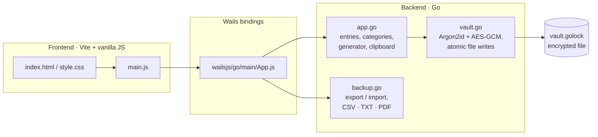

<div align="center">


# GoLock

**A lightweight, local-first desktop password manager.**

Encrypted with **Argon2id + AES-256-GCM** · Built with **Go** and **Wails** · No cloud, no accounts, no network calls.


[English](README.md) · [Português (BR)](README.pt-BR.md)

</div>

---

##  Table of contents

- [Overview](#overview)
- [Features](#features)
- [How it works](#how-it-works)
- [Getting started](#getting-started)
- [Usage guide](#usage-guide)
- [Import and export](#import-and-export)
- [Architecture](#architecture)
- [Backend API reference](#backend-api-reference)
- [Project structure](#project-structure)
- [Security model](#security-model)
- [Known limitations](#known-limitations)
- [Roadmap](#roadmap)
- [Contributing](#contributing)
- [License](#license)
- [Author](#author)

---

## Overview


GoLock is a desktop password vault. A single **master password** unlocks your vault, where you can store credentials, organize them into categories (detected automatically from the entry name), generate strong passwords, and back up or migrate your data through CSV, TXT and PDF files.

Everything stays on your computer. The vault is a single encrypted file; the master password is never written to disk. The Go backend holds all data and logic, and the frontend is plain HTML/CSS/JavaScript bundled with Vite, connected through Wails bindings. The application makes **no network calls**.

> **Project status:** early version, under active development. It has not been through an independent security audit. Read the [Security model](#security-model) and [Known limitations](#known-limitations) before storing credentials you cannot afford to lose.

## Features

### 🔐 Vault and access
- **Encrypted, persistent vault** stored as a single file on your computer (see [where your data lives](#where-your-data-lives)).
- **Master password** creation (minimum 8 characters, with confirmation) and unlock.
- **Lock** button that immediately re-locks the vault, clears the list from the UI and wipes the key and entries from memory.
- Vault operations (add, list, delete, export, import) are refused by the backend while the vault is locked.
- Safe writes: atomic saves (temp file + rename) and a `.bak` copy of the previous version.
- **Recovery key:** a 160-bit key shown once when the vault is created (and regenerated from the ⋯ menu). It opens the vault if you forget the master password; without it and the master password, nothing can be recovered.
- **Auto-lock** after 1, 5, 15 or 30 minutes of inactivity (default 5; configurable from the ⋯ menu).

### 🗂️ Password management
- **Add entries** with name, username/e-mail, password and category.
- **Edit entries** from the ⋯ menu on each card.
- **Automatic category detection** from the entry name (e.g. "Nubank" → *Banks & finance*), with manual override.
- **8 categories:** E-mails, Banks & finance, Social networks, Streaming, Games, Work, Shopping, Others.
- **Search** by name or username, plus **category chips** with counts.
- **Show / hide** each password individually.
- **Copy to clipboard** with **automatic clearing after 15 seconds** (only if the clipboard still holds the copied password).
- **Delete** with a confirmation dialog.
- **Field limits:** name and username up to 200 characters, password up to 1024.

### 🛠️ Password tools
- **Password generator:** 20 cryptographically random characters (`crypto/rand`), avoiding look-alike characters (`l`, `I`, `O`, `0`, `1`) and always including at least one lowercase letter, one uppercase letter, one digit and one symbol.
- **Strength meter** (weak, fair, good, strong) when creating the master password and on the add form.
- **Dashboard summary:** total passwords, categories in use, and a counter of weak passwords ("to improve") with a warning icon on affected cards.

### 💾 Backup
- **Export** to **PDF**, **CSV** or **TXT**, protected by master-password re-confirmation.
- **Import** from `.csv`, `.txt` and `.pdf`, including CSV files from **Chrome, Bitwarden and 1Password**.
- Smart import: automatic delimiter and encoding detection, de-duplication and a result report (added / already existed / ignored).
- GoLock PDFs embed a hidden copy of the data so they can be re-imported losslessly.

### 🎨 Interface
- Dark and light themes (follows the OS preference and remembers your choice).
- Animated background, a mascot that reacts to what you do, spark effects and toast notifications.
- Responsive layout and support for `prefers-reduced-motion`.
- Keyboard: `Enter` submits login and export forms; `Esc` closes the topmost dialog.
- User-supplied text is rendered with `textContent` (no HTML injection).

> The interface language is currently **Portuguese (pt-BR) only**; there is no in-app language switcher yet.

## How it works
| Screen | Purpose |
|---|---|
| **Login** | Create the master password (first run) or unlock. Shows a strength meter when creating. |
| **Vault** | Greeting, summary cards, search, category chips and the grouped password list. A floating **+** button adds entries. |
| **New password** | Name, user, password (with generator and strength meter), category tiles with auto-detect hint. |
| **Export / Import** | Format picker, master-password confirmation, unencrypted-file warning, import button and result report. |
| **Delete confirmation** | Prevents accidental removal. |

## Getting started

### Prerequisites

- [Go](https://go.dev/dl/) **1.25** or newer (check the `go` line in `go.mod` for the exact version)
- [Node.js](https://nodejs.org/) and npm
- [Wails CLI v2](https://wails.io/docs/gettingstarted/installation):
  `go install github.com/wailsapp/wails/v2/cmd/wails@latest`
- Platform dependencies for Wails (WebView2 on Windows, WebKitGTK and GTK3 on Linux). Run `wails doctor` to check your environment.

### Run in development

```bash
git clone https://github.com/carlosfdsn/golock.git
cd golock
wails dev
```

`wails dev` starts Vite with hot reload. A browser dev server is also exposed at `http://localhost:34115`, where the Go methods can be called from the devtools console.

### Build an executable

```bash
wails build
```

The binary is written to `build/bin/`. The frontend (`frontend/dist`) is generated during the build, so it is not versioned.

### Build with Docker (optional)

The Dockerfile works as a clean "factory": it compiles the app in an isolated environment and gives you back the executables for Windows and Linux.

```bash
docker build --target export --output ./dist .
```

Output: `./dist/golock.exe` (Windows) and `./dist/golock` (Linux).

### Run the tests

The Go package embeds `frontend/dist`, so on a fresh clone build the frontend once before running the Go tooling:

```bash
cd frontend && npm ci && npm run build && cd ..
gofmt -l .          # must print nothing
go vet ./...
go test -race ./...
```

The tests use a temporary folder as the user config directory, so they never touch your real vault. CI runs the same checks (formatting, `go vet` and race-enabled tests) on every push and pull request.

## Usage guide

1. **Create your vault.** On first launch, choose a master password (8+ characters) and repeat it. Write down the **recovery key** shown right after: it is displayed only once.
2. **Add a password.** Press **+**, type a name (the category is detected as you type), fill in user and password, optionally use the ✨ generator, and save.
3. **Find passwords.** Use the search box or the category chips.
4. **Reveal or copy.** Use the eye icon to show a password or the copy icon; the clipboard is wiped after 15 seconds.
5. **Back up.** Open the archive icon in the header, pick a format, confirm your master password and choose where to save.
6. **Restore or migrate.** In the same dialog, choose a `.csv`, `.txt` or `.pdf` file to import.
7. **Lock.** Use the lock icon in the header when you step away.
8. **Forgot the master password?** Use the forgot-password option on the login screen with your recovery key to set a new master password; your data is kept.

### Where your data lives

The vault is a single file, `vault.golock`, in your user configuration folder:

| OS | Path |
|---|---|
| Windows | `%AppData%\golock\vault.golock` |
| macOS | `~/Library/Application Support/golock/vault.golock` |
| Linux | `~/.config/golock/vault.golock` |

A `vault.golock.bak` copy of the previous version is kept next to it. **Back up this file** if you want to move the vault to another computer; you will need your master password to open it.

### Automatic categories

The first category whose keyword appears (case-insensitive substring) in the name wins. No match results in **Others**. Keywords of up to 3 letters (such as `xp`, `c6`, `pix`, `max`) only match as whole words, so a name like "Expedia" is not mistaken for a bank.

| Category (key) | Example keywords |
|---|---|
| E-mails (`email`) | gmail, outlook, hotmail, yahoo, proton, icloud, mail |
| Banks & finance (`banco`) | nubank, itau, bradesco, santander, caixa, c6, picpay, paypal, pix, binance, xp |
| Social networks (`social`) | instagram, facebook, twitter, tiktok, linkedin, whatsapp, telegram, discord, reddit |
| Streaming (`streaming`) | netflix, spotify, disney, prime, hbo, max, youtube, twitch, crunchyroll |
| Games (`jogos`) | steam, epic, xbox, playstation, riot, valorant, nintendo, roblox, minecraft |
| Work (`trabalho`) | slack, github, gitlab, notion, trello, teams, zoom, jira, figma |
| Shopping (`compras`) | amazon, mercado livre, shopee, aliexpress, magalu, shein, ifood |
| Others (`outros`) | fallback |

Longer keywords are matched as substrings, so unrelated names can occasionally match. You can always choose the category manually.

### Password strength

One point each for: length ≥ 8, length ≥ 12, upper **and** lower case, a digit, a symbol.

| Points | Level |
|---|---|
| 0–1 | Weak |
| 2 | Fair |
| 3–4 | Good |
| 5 | Strong |

Passwords rated Weak or Fair are counted under **"To improve"** on the dashboard.

## Import and export

Exports are named `golock-senhas-YYYY-MM-DD.<ext>` by default and saved with file mode `0600`. Exporting requires an unlocked vault, the correct master password and at least one entry.

> ⚠️ **Exported files are NOT encrypted** and contain every password in plain text. Store them somewhere safe, delete them after use, and never commit them to a repository (the provided `.gitignore` already blocks `golock-senhas-*`, `*.csv` and `*.pdf`).

### CSV

UTF-8 with BOM (so Excel shows accents correctly), CRLF line endings:

```csv
nome,usuario,senha,categoria
Nubank,me@example.com,s3cret!,Bancos e finanças
```

### TXT

```
golock - exportação de senhas
Gerado em: 18/10/2026 15:51
Total: 1
ATENÇÃO: este arquivo NÃO é criptografado. Guarde com cuidado.

================================================
Nome: Nubank
Usuário: me@example.com
Senha: s3cret!
Categoria: Bancos e finanças
================================================
```

### PDF

A4 document generated without any PDF library, grouped by category, with a warning banner and page numbers. Characters outside the standard WinAnsi set show as `?` **in the visible text only**. The file also carries a hidden base64 JSON payload (`GOLOCK-BEGIN:…:GOLOCK-END`) used for lossless re-import. PDFs created by other programs cannot be imported.

### Import behavior

| Aspect | Behavior |
|---|---|
| Accepted files | `.csv`, `.txt`, `.pdf` (max **20 MB**) |
| Encodings | UTF-8, UTF-8 with BOM, UTF-16 (LE/BE), ANSI/Latin-1 |
| CSV delimiter | Auto-detected: `,` `;` or tab |
| CSV columns (case- and accent-insensitive) | **password:** `senha`, `password`, `pass`, `login_password` · **name:** `nome`, `name`, `title`, `titulo`, `site`, `login_uri`, `url` · **username:** `usuario`, `username`, `user`, `login`, `login_username`, `email`, `e-mail` · **category:** `categoria`, `category`, `folder`, `grouping`, `pasta` |
| Required columns | A name column and a password column |
| Category resolution | Matches a category key or label; otherwise auto-detected from the name |
| De-duplication | Skipped if the same name + username (case-insensitive) and password already exist |
| Invalid rows | Rows without name or password, or with fields over the size limits (name/username 200, password 1024 characters), are ignored |
| Safety | Nothing is deleted or overwritten; imported entries are only appended. If saving to disk fails, the whole import is rolled back |
| Result | `X added, Y already existed, Z ignored` |

## Architecture



- **`main.go`**: configures the Wails window and embeds `frontend/dist`.
- **`app.go`**: the `App` struct (unlocked state, entries, data key; guarded by a mutex because Wails calls methods concurrently) with vault, category and password methods.
- **`vault.go`**: key derivation, encryption/decryption, file format and atomic persistence.
- **`backup.go`**: export builders, the custom PDF writer and all import parsers.
- **Frontend**: a single-page app with one module (`main.js`) and one stylesheet; state lives in module variables.

## Backend API reference

All methods are exposed to the frontend through Wails (`frontend/wailsjs/go/main/App`).

| Method | Returns | Description |
|---|---|---|
| `HasVault()` | `bool` | Whether a vault file already exists on this computer. |
| `CreateVault(master)` | `string, error` | Creates a new encrypted vault (master ≥ 8 chars) and unlocks it; returns the recovery key (shown once). Never overwrites an existing vault. |
| `Unlock(master)` | `error` | Derives the key, decrypts the vault and unlocks. |
| `Lock()` | – | Locks the vault and wipes the key and entries from memory. |
| `Categories()` | `[]Category` | List of `{key, label}`. |
| `DetectCategory(name)` | `string` | Category key inferred from a name. |
| `AddEntry(name, user, pass, category)` | `error` | Adds and saves an entry; empty/invalid category triggers auto-detection. |
| `UpdateEntry(id, name, user, pass, category)` | `error` | Edits an entry and saves; reverts the change if saving fails. |
| `ListEntries()` | `[]Entry` | Entries (empty list when locked). |
| `DeleteEntry(id)` | `error` | Removes an entry by ID and saves; keeps the entry and returns an error if saving fails. |
| `GeneratePassword(n)` | `string` | Random password; length clamped to 8–64. |
| `CopyToClipboard(text)` | – | Copies text and clears the clipboard after 15 s (only if it still holds that text). |
| `ExportEntries(format, master)` | `string, error` | Exports `pdf`/`csv`/`txt`; returns the saved path, or `""` if cancelled. |
| `ImportEntries()` | `ImportResult, error` | Opens a file dialog and imports; returns `{format, added, skipped, invalid}`. |
| `HasRecoveryKey()` | `bool` | Whether the vault has a recovery key (works while locked). |
| `GenerateRecoveryKey(master)` | `string, error` | Creates a new recovery key (the previous one stops working); requires the master password. |
| `RecoverVault(recoveryKey, newMaster)` | `string, error` | Opens the vault with the recovery key, sets a new master password and returns a new recovery key. Data is preserved. |

```go
type Entry struct { ID int; Name, Username, Password, Category string }
type Category struct { Key, Label string }
type ImportResult struct { Format string; Added, Skipped, Invalid int }
```

## Project structure

```
golock/
├── main.go               # Wails entry point and window options
├── app.go                # Entries, categories, generator, clipboard
├── vault.go              # Encryption, key derivation, vault file I/O
├── backup.go             # Export (CSV/TXT/PDF) and import parsers
├── wails.json            # Wails project configuration
├── Dockerfile            # Reproducible Windows + Linux build
├── *_test.go             # Tests: vault security, app flows, import/export
├── .github/workflows/    # CI (checks) and release builds
├── go.mod / go.sum
└── frontend/
    ├── index.html        # All screens and dialogs
    ├── package.json      # Vite scripts
    ├── src/
    │   ├── main.js       # UI logic
    │   ├── style.css     # Theme, layout and animations
    │   └── assets/       # Mascot images, fonts
    └── wailsjs/          # Auto-generated Go ↔ JS bindings (do not edit)
```

## Security model

| Aspect | Implementation |
|---|---|
| Key derivation | **Argon2id**, 3 iterations, 64 MiB memory, 4 threads, random 16-byte salt per vault |
| Encryption | **AES-256-GCM** (confidentiality and tamper detection), fresh random nonce on every save |
| Key hierarchy | A random 256-bit data key encrypts the vault; it is stored wrapped by the master-password key and, optionally, by a key derived from the recovery key (160 random bits) |
| Authenticated header | KDF parameters, salt and version are bound to the ciphertext as AAD, so changing them makes decryption fail |
| Master password | Never written to disk |
| Memory | The data key and entries are wiped on lock and on exit; the master password is not retained. Go strings cannot be zeroed, so this is best effort |
| Malicious files | KDF parameters read from a file are capped, so a crafted vault cannot request absurd resources |
| File permissions | Vault `0600` / folder `0700`; exports `0600` |
| Writes | Atomic (temp file, `fsync`, rename) with a `.bak` of the previous version |
| Random numbers | `crypto/rand` for salts, nonces and the password generator |
| Network | None. Data leaves the device only if you export it |
| UI | User text rendered with `textContent`, preventing HTML injection |

## Known limitations

- **Not independently audited.** Treat it as a learning/portfolio project until it has been reviewed.
- **Memory wiping is best effort.** Locking wipes the data key and the entry list, but Go strings are immutable, so copies of passwords may linger until garbage-collected, and the OS may swap memory to disk.
- **Weak master password = weak vault.** Argon2id slows guessing down but cannot save a short or common password. Use a long passphrase.
- **No brute-force throttling** on unlock beyond the Argon2id cost.
- **Exports are plain text** (see the in-app warning).
- **CSV exports are not escaped against spreadsheet formulas** (needed for lossless re-import): values starting with `=`, `+`, `-` or `@` are written as-is and could be interpreted as formulas when opened in a spreadsheet.
- **Clipboard clearing** happens 15 s after copying and only if the clipboard still holds the copied text; clipboard-history tools (such as Windows `Win+V`) may keep their own copy.
- **The `.bak` copy keeps the previous version**, which still opens with the previous master password and recovery key. If you reset the password because it may have leaked, delete `vault.golock.bak` afterwards.
- **No backdoor:** if you lose both the master password and the recovery key, the data cannot be recovered. For now, the master password can only be changed through the recovery key.
- **UI is pt-BR only.**

## Roadmap

- [x] Zero key and entries in memory on lock
- [x] Edit existing entries
- [ ] Change master password
- [x] Auto-lock on inactivity
- [ ] Language switcher (pt-BR / English)
- [ ] Encrypted export format
- [x] Automated tests for category detection, vault encryption and import/export parsers
- [ ] CI with `go vet` and `govulncheck` (`go vet`, `gofmt` and race-enabled tests already run in CI; `govulncheck` is still missing)

## Contributing

Issues and pull requests are welcome. For security problems, please **do not** open a public issue with exploit details; contact the author directly first. Before opening a pull request, run `gofmt -l .`, `go vet ./...` and `go test -race ./...` (see [Run the tests](#run-the-tests)).

## License

See the [LICENSE](LICENSE) file.

## Author

 **carlosfdsn**. Created with Go + Wails.