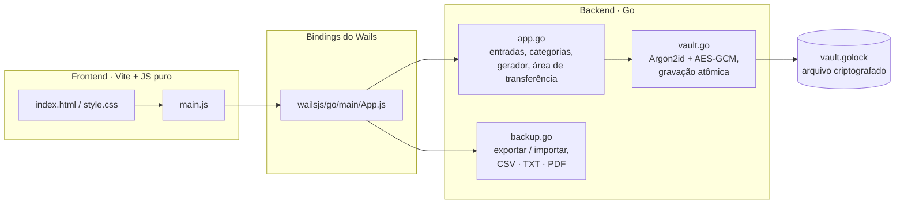

<div align="center">


# GoLock

**Um gerenciador de senhas de desktop leve e 100% local.**

Criptografado com **Argon2id + AES-256-GCM** · Feito com **Go** e **Wails** · Sem nuvem, sem contas, sem chamadas de rede.


[English](README.md) · [Português (BR)](README.pt-BR.md)

</div>

---

##  Sumário

- [Visão geral](#visão-geral)
- [Funcionalidades](#funcionalidades)
- [Como funciona](#como-funciona)
- [Primeiros passos](#primeiros-passos)
- [Guia de uso](#guia-de-uso)
- [Importação e exportação](#importação-e-exportação)
- [Arquitetura](#arquitetura)
- [Referência da API do backend](#referência-da-api-do-backend)
- [Estrutura do projeto](#estrutura-do-projeto)
- [Modelo de segurança](#modelo-de-segurança)
- [Limitações conhecidas](#limitações-conhecidas)
- [Roadmap](#roadmap)
- [Contribuindo](#contribuindo)
- [Licença](#licença)
- [Autor](#autor)

---

## Visão geral


O GoLock é um cofre de senhas para desktop. Uma única **senha mestra** abre o cofre, onde você guarda credenciais, organiza em categorias (detectadas automaticamente pelo nome), gera senhas fortes e faz backup ou migração dos dados por arquivos CSV, TXT e PDF.

Tudo fica no seu computador. O cofre é um único arquivo criptografado, e a senha mestra nunca é gravada em disco. O backend em Go guarda todos os dados e a lógica; o frontend é HTML/CSS/JavaScript puro empacotado com Vite, ligado ao Go pelos bindings do Wails. O aplicativo **não faz nenhuma chamada de rede**.

> **Status do projeto:** versão inicial, em desenvolvimento ativo. Ainda não passou por auditoria de segurança independente. Leia o [Modelo de segurança](#modelo-de-segurança) e as [Limitações conhecidas](#limitações-conhecidas) antes de guardar credenciais que você não pode perder.

## Funcionalidades

### 🔐 Cofre e acesso
- **Cofre criptografado e persistente**, salvo em um único arquivo no seu computador (veja [onde ficam seus dados](#onde-ficam-seus-dados)).
- Criação da **senha mestra** (mínimo de 8 caracteres, com confirmação) e desbloqueio.
- Botão de **travar** que bloqueia o cofre na hora e limpa a lista da tela.
- As operações do cofre (adicionar, listar, apagar, exportar, importar) são recusadas pelo backend enquanto ele estiver travado.
- Gravação segura: salvamento atômico (arquivo temporário + rename) e uma cópia `.bak` da versão anterior.

### 🗂️ Gerenciamento de senhas
- **Adicionar entradas** com nome, usuário/e-mail, senha e categoria.
- **Detecção automática de categoria** pelo nome (ex.: "Nubank" → *Bancos e finanças*), com escolha manual.
- **8 categorias:** E-mails, Bancos e finanças, Redes sociais, Streaming, Jogos, Trabalho, Compras, Outros.
- **Busca** por nome ou usuário, mais **chips de categoria** com contagem.
- **Mostrar / ocultar** cada senha individualmente.
- **Copiar** para a área de transferência, que é **limpa automaticamente após 15 segundos**.
- **Apagar** com diálogo de confirmação.

### 🛠️ Ferramentas de senha
- **Gerador de senhas:** 20 caracteres aleatórios criptograficamente seguros (`crypto/rand`), sem caracteres parecidos (`l`, `I`, `O`, `0`, `1`).
- **Medidor de força** (fraca, razoável, boa, forte) na criação da senha mestra e no formulário de nova senha.
- **Resumo no painel:** total de senhas, categorias em uso e contador de senhas fracas ("para melhorar"), com ícone de alerta nos cartões afetados.

### 💾 Backup
- **Exportar** para **PDF**, **CSV** ou **TXT**, protegido por nova confirmação da senha mestra.
- **Importar** de `.csv`, `.txt` e `.pdf`, incluindo CSVs do **Chrome, Bitwarden e 1Password**.
- Importação inteligente: detecção automática de delimitador e codificação, remoção de duplicatas e relatório do resultado (adicionadas / já existiam / ignoradas).
- Os PDFs do GoLock levam uma cópia oculta dos dados, para reimportar sem perder nada.

### 🎨 Interface
- Temas escuro e claro (seguem o sistema e lembram sua escolha).
- Fundo animado, mascote que reage às suas ações, efeitos de faíscas e notificações (toasts).
- Layout responsivo e suporte a `prefers-reduced-motion`.
- Teclado: `Enter` envia os formulários de login e exportação; `Esc` fecha o diálogo do topo.
- Textos digitados pelo usuário são exibidos com `textContent` (sem injeção de HTML).

> A interface está, por enquanto, **somente em português (pt-BR)**; ainda não há seletor de idioma no app.

## Como funciona
| Tela | Função |
|---|---|
| **Login** | Criar a senha mestra (primeiro uso) ou desbloquear. Mostra o medidor de força ao criar. |
| **Cofre** | Saudação, cartões de resumo, busca, chips de categoria e a lista de senhas agrupada. O botão flutuante **+** adiciona entradas. |
| **Nova senha** | Nome, usuário, senha (com gerador e medidor de força), blocos de categoria com dica de detecção automática. |
| **Exportar / Importar** | Escolha de formato, confirmação da senha mestra, aviso de arquivo sem criptografia, botão de importar e relatório. |
| **Confirmação de exclusão** | Evita apagar sem querer. |

## Primeiros passos

### Pré-requisitos

- [Go](https://go.dev/dl/) **1.25** ou superior
- [Node.js](https://nodejs.org/) e npm
- [Wails CLI v2](https://wails.io/docs/gettingstarted/installation):
  `go install github.com/wailsapp/wails/v2/cmd/wails@latest`
- Dependências de plataforma do Wails (WebView2 no Windows, WebKitGTK e GTK3 no Linux). Rode `wails doctor` para checar o ambiente.

### Rodar em desenvolvimento

```bash
git clone https://github.com/carlosfdsn/golock.git
cd golock
wails dev
```

O `wails dev` inicia o Vite com hot reload. Também há um servidor de desenvolvimento em `http://localhost:34115`, onde dá para chamar os métodos do Go pelo console do navegador.

### Gerar o executável

```bash
wails build
```

O binário é gerado em `build/bin/`. O frontend (`frontend/dist`) é criado durante o build, por isso não é versionado.

### Compilar com Docker (opcional)

O Dockerfile funciona como uma "fábrica" limpa: compila o app em um ambiente isolado e devolve os executáveis para Windows e Linux.

```bash
docker build --target export --output ./dist .
```

Saída: `./dist/golock.exe` (Windows) e `./dist/golock` (Linux).

## Guia de uso

1. **Crie seu cofre.** No primeiro uso, escolha uma senha mestra (8+ caracteres) e repita-a.
2. **Adicione uma senha.** Clique em **+**, digite um nome (a categoria é detectada enquanto você digita), preencha usuário e senha, use o gerador ✨ se quiser e salve.
3. **Encontre senhas.** Use a busca ou os chips de categoria.
4. **Mostre ou copie.** Use o ícone de olho para ver a senha ou o de copiar; a área de transferência é limpa após 15 segundos.
5. **Faça backup.** Abra o ícone de arquivo no cabeçalho, escolha o formato, confirme a senha mestra e escolha onde salvar.
6. **Restaure ou migre.** No mesmo diálogo, escolha um arquivo `.csv`, `.txt` ou `.pdf` para importar.
7. **Trave.** Use o ícone de cadeado no cabeçalho quando se afastar.

### Onde ficam seus dados

O cofre é um único arquivo, `vault.golock`, na pasta de configuração do usuário:

| Sistema | Caminho |
|---|---|
| Windows | `%AppData%\golock\vault.golock` |
| macOS | `~/Library/Application Support/golock/vault.golock` |
| Linux | `~/.config/golock/vault.golock` |

Uma cópia `vault.golock.bak` da versão anterior fica ao lado. **Faça backup desse arquivo** se quiser levar o cofre para outro computador; você vai precisar da sua senha mestra para abri-lo.

### Categorias automáticas

Vence a primeira categoria cuja palavra-chave aparece (substring, sem diferenciar maiúsculas) no nome. Se nenhuma bater, cai em **Outros**.

| Categoria (chave) | Exemplos de palavras-chave |
|---|---|
| E-mails (`email`) | gmail, outlook, hotmail, yahoo, proton, icloud, mail |
| Bancos e finanças (`banco`) | nubank, itau, bradesco, santander, caixa, c6, picpay, paypal, pix, binance, xp |
| Redes sociais (`social`) | instagram, facebook, twitter, tiktok, linkedin, whatsapp, telegram, discord, reddit |
| Streaming (`streaming`) | netflix, spotify, disney, prime, hbo, max, youtube, twitch, crunchyroll |
| Jogos (`jogos`) | steam, epic, xbox, playstation, riot, valorant, nintendo, roblox, minecraft |
| Trabalho (`trabalho`) | slack, github, gitlab, notion, trello, teams, zoom, jira, figma |
| Compras (`compras`) | amazon, mercado livre, shopee, aliexpress, magalu, shein, ifood |
| Outros (`outros`) | padrão |

Como a busca é por substring, palavras curtas às vezes batem em nomes sem relação. Você sempre pode escolher a categoria manualmente.

### Força da senha

Um ponto para cada item: tamanho ≥ 8, tamanho ≥ 12, maiúsculas **e** minúsculas, um número, um símbolo.

| Pontos | Nível |
|---|---|
| 0–1 | Fraca |
| 2 | Razoável |
| 3–4 | Boa |
| 5 | Forte |

Senhas Fracas ou Razoáveis entram na contagem **"Para melhorar"** do painel.

## Importação e exportação

Os arquivos exportados se chamam `golock-senhas-AAAA-MM-DD.<ext>` por padrão e são salvos com permissão `0600`. Exportar exige o cofre destravado, a senha mestra correta e pelo menos uma entrada.

> ⚠️ **Os arquivos exportados NÃO são criptografados** e contêm todas as senhas em texto puro. Guarde-os em local seguro, apague depois de usar e nunca os envie para um repositório (o `.gitignore` do projeto já bloqueia `golock-senhas-*`, `*.csv` e `*.pdf`).

### CSV

UTF-8 com BOM (para o Excel mostrar os acentos), quebras de linha CRLF:

```csv
nome,usuario,senha,categoria
Nubank,me@example.com,s3cret!,Bancos e finanças
```

### TXT

```
golock - exportação de senhas
Gerado em: 18/10/2026 15:51
Total: 1
ATENÇÃO: este arquivo NÃO é criptografado. Guarde com cuidado.

================================================
Nome: Nubank
Usuário: me@example.com
Senha: s3cret!
Categoria: Bancos e finanças
================================================
```

### PDF

Documento A4 gerado sem nenhuma biblioteca de PDF, agrupado por categoria, com faixa de aviso e numeração de páginas. Caracteres fora do conjunto padrão WinAnsi aparecem como `?` **apenas no texto visível**. O arquivo também leva um JSON em base64 oculto (`GOLOCK-BEGIN:…:GOLOCK-END`), usado na reimportação sem perdas. PDFs criados por outros programas não podem ser importados.

### Comportamento da importação

| Aspecto | Comportamento |
|---|---|
| Arquivos aceitos | `.csv`, `.txt`, `.pdf` (máx. **20 MB**) |
| Codificações | UTF-8, UTF-8 com BOM, UTF-16 (LE/BE), ANSI/Latin-1 |
| Delimitador do CSV | Detectado automaticamente: `,` `;` ou tabulação |
| Colunas do CSV (sem diferenciar maiúsculas e acentos) | **senha:** `senha`, `password`, `pass`, `login_password` · **nome:** `nome`, `name`, `title`, `titulo`, `site`, `login_uri`, `url` · **usuário:** `usuario`, `username`, `user`, `login`, `login_username`, `email`, `e-mail` · **categoria:** `categoria`, `category`, `folder`, `grouping`, `pasta` |
| Colunas obrigatórias | Uma coluna de nome e uma de senha |
| Resolução de categoria | Casa com a chave ou o rótulo; senão, é detectada pelo nome |
| Duplicatas | Ignorada se já existir a mesma combinação nome + usuário (sem diferenciar maiúsculas) e senha |
| Linhas inválidas | Linhas sem nome ou senha são ignoradas |
| Segurança | Nada é apagado nem sobrescrito; as entradas importadas só são acrescentadas |
| Resultado | `X adicionadas, Y já existiam, Z ignoradas` |

## Arquitetura



- **`main.go`**: configura a janela do Wails e embute o `frontend/dist`.
- **`app.go`**: a struct `App` (estado de travado/destravado, entradas, chave derivada) com os métodos de cofre, categorias e senhas.
- **`vault.go`**: derivação de chave, criptografia/descriptografia, formato do arquivo e persistência atômica.
- **`backup.go`**: geradores de exportação, o escritor de PDF próprio e todos os parsers de importação.
- **Frontend**: aplicação de página única com um módulo (`main.js`) e uma folha de estilo; o estado vive em variáveis do módulo.

## Referência da API do backend

Todos os métodos são expostos ao frontend pelo Wails (`frontend/wailsjs/go/main/App`).

| Método | Retorno | Descrição |
|---|---|---|
| `HasVault()` | `bool` | Se já existe um arquivo de cofre neste computador. |
| `CreateVault(master)` | `error` | Cria um cofre criptografado novo (master ≥ 8 caracteres) e destrava. Nunca sobrescreve um cofre existente. |
| `Unlock(master)` | `error` | Deriva a chave, descriptografa o cofre e destrava. |
| `Lock()` | – | Trava o cofre. |
| `Categories()` | `[]Category` | Lista de `{key, label}`. |
| `DetectCategory(name)` | `string` | Chave de categoria deduzida do nome. |
| `AddEntry(name, user, pass, category)` | `error` | Adiciona e salva uma entrada; categoria vazia/inválida ativa a detecção automática. |
| `ListEntries()` | `[]Entry` | Entradas (lista vazia se travado). |
| `DeleteEntry(id)` | – | Remove uma entrada pelo ID e salva. |
| `GeneratePassword(n)` | `string` | Senha aleatória; tamanho limitado a 8–64. |
| `CopyToClipboard(text)` | – | Copia o texto e limpa a área de transferência após 15 s. |
| `ExportEntries(format, master)` | `string, error` | Exporta `pdf`/`csv`/`txt`; devolve o caminho salvo, ou `""` se cancelado. |
| `ImportEntries()` | `ImportResult, error` | Abre o seletor de arquivo e importa; devolve `{format, added, skipped, invalid}`. |

```go
type Entry struct { ID int; Name, Username, Password, Category string }
type Category struct { Key, Label string }
type ImportResult struct { Format string; Added, Skipped, Invalid int }
```

## Estrutura do projeto

```
golock/
├── main.go               # Ponto de entrada do Wails e opções da janela
├── app.go                # Entradas, categorias, gerador, área de transferência
├── vault.go              # Criptografia, derivação de chave, arquivo do cofre
├── backup.go             # Exportação (CSV/TXT/PDF) e parsers de importação
├── wails.json            # Configuração do projeto Wails
├── Dockerfile            # Build reproduzível para Windows + Linux
├── go.mod / go.sum
└── frontend/
    ├── index.html        # Todas as telas e diálogos
    ├── package.json      # Scripts do Vite
    ├── src/
    │   ├── main.js       # Lógica da interface
    │   ├── style.css     # Tema, layout e animações
    │   └── assets/       # Imagens do mascote, fontes
    └── wailsjs/          # Bindings Go ↔ JS gerados automaticamente (não editar)
```

## Modelo de segurança

| Aspecto | Implementação |
|---|---|
| Derivação de chave | **Argon2id**, 3 iterações, 64 MiB de memória, 4 threads, sal aleatório de 16 bytes por cofre |
| Criptografia | **AES-256-GCM** (confidencialidade e detecção de adulteração), nonce aleatório novo a cada gravação |
| Cabeçalho autenticado | Parâmetros do KDF, sal e versão ficam presos ao texto cifrado como AAD; alterá-los faz a descriptografia falhar |
| Senha mestra | Nunca é gravada em disco |
| Arquivos maliciosos | Os parâmetros do KDF lidos de um arquivo têm limite, então um cofre forjado não consegue pedir recursos absurdos |
| Permissões | Cofre `0600` / pasta `0700`; exportações `0600` |
| Gravação | Atômica (temporário, `fsync`, rename) com `.bak` da versão anterior |
| Aleatoriedade | `crypto/rand` para sais, nonces e gerador de senhas |
| Rede | Nenhuma. Os dados só saem do dispositivo se você exportar |
| Interface | Texto do usuário exibido com `textContent`, evitando injeção de HTML |

## Limitações conhecidas

- **Sem auditoria independente.** Trate como projeto de estudo/portfólio até ser revisado.
- **Travar ainda não limpa a memória.** Depois de travar, a chave derivada e as entradas continuam na memória do processo até o app fechar. (Correção planejada: zerar ao travar.)
- **Senha mestra fraca = cofre fraco.** O Argon2id deixa as tentativas mais lentas, mas não salva uma senha curta ou comum. Use uma frase longa.
- **Sem limitação de tentativas** no desbloqueio além do custo do Argon2id.
- **Exportações são texto puro** (veja o aviso no app).
- **A limpeza da área de transferência** acontece sempre após 15 s, mesmo que você tenha copiado outra coisa nesse meio tempo.
- **Sem trava automática** por inatividade e **sem edição** de entradas existentes ainda (apague e adicione de novo).
- **Sem troca de senha mestra** e sem recuperação do cofre se a senha for esquecida. Não existe porta dos fundos.
- **Interface apenas em pt-BR.**

## Roadmap

- [ ] Zerar chave e entradas na memória ao travar
- [ ] Editar entradas existentes
- [ ] Trocar a senha mestra
- [ ] Trava automática por inatividade
- [ ] Seletor de idioma (pt-BR / inglês)
- [ ] Formato de exportação criptografado
- [ ] Testes automatizados para detecção de categoria, criptografia do cofre e parsers de importação/exportação
- [ ] CI com `go vet` e `govulncheck`

## Contribuindo

Issues e pull requests são bem-vindos. Para problemas de segurança, **não** abra uma issue pública com detalhes de exploração; fale primeiro diretamente com o autor.

## Licença

Veja o arquivo [LICENSE](LICENSE).

## Autor

 **carlosfdsn**. Criado com Go + Wails.