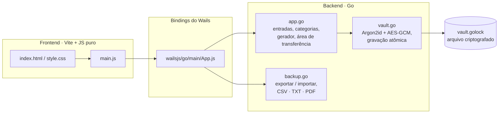

<div align="center">


# GoLock

**Um gerenciador de senhas de desktop leve e 100% local.**

Criptografado com **Argon2id + AES-256-GCM** · Feito com **Go** e **Wails** · Sem nuvem, sem contas, sem chamadas de rede.


[English](README.md) · [Português (BR)](README.pt-BR.md)

</div>

---

##  Sumário

- [Visão geral](#visão-geral)
- [Funcionalidades](#funcionalidades)
- [Como funciona](#como-funciona)
- [Primeiros passos](#primeiros-passos)
- [Guia de uso](#guia-de-uso)
- [Importação e exportação](#importação-e-exportação)
- [Arquitetura](#arquitetura)
- [Referência da API do backend](#referência-da-api-do-backend)
- [Estrutura do projeto](#estrutura-do-projeto)
- [Modelo de segurança](#modelo-de-segurança)
- [Limitações conhecidas](#limitações-conhecidas)
- [Roadmap](#roadmap)
- [Contribuindo](#contribuindo)
- [Licença](#licença)
- [Autor](#autor)

---

## Visão geral


O GoLock é um cofre de senhas para desktop. Uma única **senha mestra** abre o cofre, onde você guarda credenciais, organiza em categorias (detectadas automaticamente pelo nome), gera senhas fortes e faz backup ou migração dos dados por arquivos CSV, TXT e PDF.

Tudo fica no seu computador. O cofre é um único arquivo criptografado, e a senha mestra nunca é gravada em disco. O backend em Go guarda todos os dados e a lógica; o frontend é HTML/CSS/JavaScript puro empacotado com Vite, ligado ao Go pelos bindings do Wails. O aplicativo **não faz nenhuma chamada de rede**.

> **Status do projeto:** versão inicial, em desenvolvimento ativo. Ainda não passou por auditoria de segurança independente. Leia o [Modelo de segurança](#modelo-de-segurança) e as [Limitações conhecidas](#limitações-conhecidas) antes de guardar credenciais que você não pode perder.

## Funcionalidades

### 🔐 Cofre e acesso
- **Cofre criptografado e persistente**, salvo em um único arquivo no seu computador (veja [onde ficam seus dados](#onde-ficam-seus-dados)).
- Criação da **senha mestra** (mínimo de 8 caracteres, com confirmação) e desbloqueio.
- Botão de **travar** que bloqueia o cofre na hora, limpa a lista da tela e apaga a chave e as entradas da memória.
- As operações do cofre (adicionar, listar, editar, apagar, exportar e importar) são recusadas pelo backend enquanto ele estiver travado.
- Gravação segura: salvamento atômico (arquivo temporário + rename) e uma cópia `.bak` da versão anterior.
- **Chave de recuperação:** uma chave de 160 bits mostrada ao criar o cofre (e que pode ser gerada novamente pelo menu ⋯). Ela permite recuperar o acesso caso você esqueça a senha mestra. Ao gerar uma nova chave, a anterior deixa de funcionar.
- **Trava automática** após 1, 5, 15 ou 30 minutos de inatividade (padrão: 5 minutos; configurável pelo menu ⋯).

### 🗂️ Gerenciamento de senhas
- **Adicionar entradas** com nome, usuário/e-mail, senha e categoria.
- **Editar entradas** pelo menu ⋯ de cada cartão.
- **Detecção automática de categoria** pelo nome (ex.: "Nubank" → *Bancos e finanças*), com possibilidade de escolha manual.
- **8 categorias:** E-mails, Bancos e finanças, Redes sociais, Streaming, Jogos, Trabalho, Compras e Outros.
- **Busca** por nome ou usuário, além de **chips de categoria** com contagem de entradas.
- **Mostrar / ocultar** cada senha individualmente.
- **Copiar** para a área de transferência, que é **limpa automaticamente após 15 segundos** (somente se ela ainda contiver o texto copiado).
- **Apagar** entradas com diálogo de confirmação.
- **Limites dos campos:** nome e usuário até 200 caracteres, senha até 1024.

### 🛠️ Ferramentas de senha
- **Gerador de senhas:** gera senhas de 20 caracteres criptograficamente seguros (`crypto/rand`), evitando caracteres parecidos (`l`, `I`, `O`, `0`, `1`) e garantindo pelo menos uma letra minúscula, uma maiúscula, um número e um símbolo.
- **Medidor de força** (fraca, razoável, boa, forte) na criação da senha mestra e no formulário de senhas.
- **Resumo no painel:** total de senhas, categorias em uso e contador de senhas fracas ("para melhorar"), com ícone de alerta nos cartões afetados.

### 💾 Backup
- **Exportar** para **PDF**, **CSV** ou **TXT**, protegido por nova confirmação da senha mestra.
- **Importar** de `.csv`, `.txt` e `.pdf`, incluindo CSVs do **Chrome, Bitwarden e 1Password**.
- Importação inteligente: detecção automática de delimitador e codificação, identificação de duplicatas e relatório do resultado (adicionadas / já existiam / ignoradas).
- Os PDFs gerados pelo GoLock levam uma cópia oculta dos dados, permitindo reimportar as entradas sem perder informações.

### 🎨 Interface
- Temas escuro e claro (seguem a preferência do sistema e lembram sua escolha).
- Mascote que reage às suas ações, efeitos visuais e notificações (toasts).
- Layout adaptável a diferentes tamanhos de janela, com redimensionamento e ajustes para telas menores.
- Suporte a `prefers-reduced-motion`, respeitando a preferência do sistema por menos animações.
- Teclado: `Enter` envia os formulários de login e exportação; `Esc` fecha o diálogo do topo.
- Textos digitados pelo usuário são exibidos com `textContent`, evitando injeção de HTML.

> A interface está, por enquanto, **somente em português (pt-BR)**; ainda não há seletor de idioma no app.

## Como funciona

| Tela | Função |
|---|---|
| **Login** | Criar a senha mestra (primeiro uso) ou desbloquear. Mostra o medidor de força ao criar. |
| **Cofre** | Saudação, cartões de resumo, busca, chips de categoria e lista de senhas agrupada. O botão flutuante **+** adiciona entradas. |
| **Nova senha** | Nome, usuário, senha (com gerador e medidor de força), blocos de categoria com indicação de detecção automática. |
| **Exportar / Importar** | Escolha de formato, confirmação da senha mestra, aviso de arquivo sem criptografia, seleção de arquivo para importar e relatório do resultado. |
| **Confirmação de exclusão** | Evita apagar entradas sem querer. |

## Primeiros passos

### Pré-requisitos

- [Go](https://go.dev/dl/) **1.27.2** ou superior (versão declarada no `go.mod`).
- [Node.js](https://nodejs.org/) e npm (o projeto utiliza Node.js 22 no CI).
- [Wails CLI v2](https://wails.io/docs/gettingstarted/installation):
  `go install github.com/wailsapp/wails/v2/cmd/wails@v2.17.0`
- Dependências de plataforma do Wails (WebView2 no Windows, WebKitGTK e GTK3 no Linux). Rode `wails doctor` para verificar o ambiente.

### Rodar em desenvolvimento

```bash
git clone https://github.com/carlosfdsn/golock.git
cd golock
wails dev
```

O `wails dev` inicia o Vite com hot reload. Também há um servidor de desenvolvimento em `http://localhost:34115`, onde é possível chamar os métodos do Go pelo console do navegador.

### Gerar o executável

```bash
wails build
```

O binário é gerado em `build/bin/`. O frontend (`frontend/dist`) é criado durante o build, por isso não é versionado.

### Compilar com Docker (opcional)

O Dockerfile funciona como uma "fábrica" de compilação: constrói o aplicativo em um ambiente isolado e disponibiliza os executáveis para Windows e Linux.

```bash
docker build --target export --output ./dist .
```

Saída esperada:

- `./dist/golock.exe` — Windows.
- `./dist/golock` — Linux.

O ambiente Docker utiliza o mecanismo automático de toolchain do Go para obter a versão exigida pelo `go.mod`.

### Rodar os testes

O pacote Go embute o `frontend/dist`; por isso, em um clone novo, gere o frontend uma vez antes de usar as ferramentas do Go:

```bash
cd frontend && npm ci && npm run build && cd ..
gofmt -l .          # não deve imprimir nada
go vet ./...
go test -race ./...
go build ./...
```

Os testes usam uma pasta temporária como pasta de configuração, então não mexem no seu cofre de verdade. O CI executa verificações de formatação, `go vet`, testes com detector de corrida e compilação do projeto a cada push e pull request.

## Guia de uso

1. **Crie seu cofre.** No primeiro uso, escolha uma senha mestra (8+ caracteres) e repita-a. Guarde a **chave de recuperação** apresentada em seguida em um local seguro.
2. **Adicione uma senha.** Clique em **+**, digite um nome (a categoria é detectada enquanto você digita), preencha usuário e senha, use o gerador ✨ se quiser e salve.
3. **Encontre senhas.** Use a busca ou os chips de categoria.
4. **Mostre ou copie.** Use o ícone de olho para ver uma senha ou o de copiar; a área de transferência é limpa após 15 segundos, se ainda contiver o texto copiado.
5. **Faça backup.** Abra o ícone de arquivo no cabeçalho, escolha o formato, confirme a senha mestra e escolha onde salvar.
6. **Restaure ou migre.** No mesmo diálogo, escolha um arquivo `.csv`, `.txt` ou `.pdf` para importar.
7. **Trave.** Use o ícone de cadeado no cabeçalho quando se afastar.
8. **Esqueceu a senha mestra?** Use a opção de recuperação na tela de login e informe sua chave de recuperação para definir uma nova senha mestra. Seus dados serão preservados e uma nova chave de recuperação será apresentada.

### Onde ficam seus dados

O cofre é um único arquivo, `vault.golock`, na pasta de configuração do usuário:

| Sistema | Caminho |
|---|---|
| Windows | `%AppData%\golock\vault.golock` |
| macOS | `~/Library/Application Support/golock/vault.golock` |
| Linux | `~/.config/golock/vault.golock` |

Uma cópia `vault.golock.bak` da versão anterior fica ao lado. **Faça backup desse arquivo** se quiser levar o cofre para outro computador; você precisará da senha mestra para abri-lo.

### Categorias automáticas

A primeira categoria cuja palavra-chave corresponde ao nome é selecionada. A comparação não diferencia maiúsculas de minúsculas. Palavras-chave curtas, com até 3 caracteres (como `xp`, `c6`, `pix` e `max`), só correspondem a palavras inteiras. Assim, um nome como "Expedia" não é confundido com um banco.

| Categoria (chave) | Exemplos de palavras-chave |
|---|---|
| E-mails (`email`) | gmail, outlook, hotmail, yahoo, proton, icloud, e-mail, email, mail |
| Bancos e finanças (`banco`) | banco, bank, nubank, itau, bradesco, santander, caixa, c6, picpay, paypal, mercado pago, pix, cartao, cartão, corretora, xp, binance |
| Redes sociais (`social`) | instagram, facebook, twitter, tiktok, linkedin, whatsapp, telegram, discord, reddit, pinterest, snapchat, threads |
| Streaming (`streaming`) | netflix, spotify, disney, prime, hbo, max, youtube, globoplay, deezer, twitch, crunchyroll |
| Jogos (`jogos`) | steam, epic, xbox, playstation, psn, riot, valorant, nintendo, roblox, minecraft, battle.net |
| Trabalho (`trabalho`) | slack, github, gitlab, notion, trello, teams, zoom, jira, figma, google drive, empresa, trabalho |
| Compras (`compras`) | amazon, mercado livre, mercadolivre, shopee, aliexpress, magalu, americanas, shein, ifood, loja |
| Outros (`outros`) | padrão |

As palavras-chave maiores são procuradas dentro do nome. Por isso, nomes sem relação podem ocasionalmente corresponder a alguma categoria. Você sempre pode escolher a categoria manualmente.

### Força da senha

O medidor atribui um ponto para cada critério atendido:

- Tamanho igual ou superior a 8 caracteres.
- Tamanho igual ou superior a 12 caracteres.
- Presença de letras maiúsculas **e** minúsculas.
- Presença de um número.
- Presença de um símbolo.

| Pontos | Nível |
|---|---|
| 0–1 | Fraca |
| 2 | Razoável |
| 3–4 | Boa |
| 5 | Forte |

Senhas Fracas ou Razoáveis entram na contagem **"Para melhorar"** do painel.

## Importação e exportação

Os arquivos exportados recebem o nome `golock-senhas-AAAA-MM-DD.<ext>` por padrão e são salvos com permissão `0600`. Exportar exige que o cofre esteja destravado, que a senha mestra esteja correta e que exista pelo menos uma entrada.

> ⚠️ **Os arquivos exportados NÃO são criptografados** e contêm todas as senhas em texto puro. Guarde-os em local seguro, apague-os depois de usar e nunca os envie para um repositório. O `.gitignore` do projeto já bloqueia `golock-senhas-*`, `*.csv` e `*.pdf`.

### CSV

Arquivo em UTF-8 com BOM (para o Excel mostrar os acentos corretamente), com quebras de linha CRLF:

```csv
nome,usuario,senha,categoria
Nubank,me@example.com,s3cret!,Bancos e finanças
```

### TXT

```text
golock - exportação de senhas
Gerado em: 18/10/2026 15:51
Total: 1
ATENÇÃO: este arquivo NÃO é criptografado. Guarde com cuidado.

================================================
Nome: Nubank
Usuário: me@example.com
Senha: s3cret!
Categoria: Bancos e finanças
================================================
```

### PDF

Documento A4 gerado sem biblioteca externa de PDF, agrupado por categoria, com faixa de aviso e numeração de páginas. Caracteres fora do conjunto padrão WinAnsi aparecem como `?` **apenas no texto visível**. O arquivo também contém um JSON em base64 oculto (`GOLOCK-BEGIN:…:GOLOCK-END`), utilizado na reimportação sem perda de informações.

**Atenção:** somente PDFs gerados pelo GoLock podem ser importados. PDFs criados por outros programas não são compatíveis.

### Comportamento da importação

| Aspecto | Comportamento |
|---|---|
| Arquivos aceitos | `.csv`, `.txt`, `.pdf` (máx. **20 MB**) |
| Codificações | UTF-8, UTF-8 com BOM, UTF-16 (LE/BE), ANSI/Latin-1 |
| Delimitador do CSV | Detectado automaticamente: `,`, `;` ou tabulação |
| Colunas do CSV (sem diferenciar maiúsculas e acentos) | **senha:** `senha`, `password`, `pass`, `login_password` · **nome:** `nome`, `name`, `title`, `titulo`, `site`, `login_uri`, `url` · **usuário:** `usuario`, `username`, `user`, `login`, `login_username`, `email`, `e-mail` · **categoria:** `categoria`, `category`, `folder`, `grouping`, `pasta` |
| Colunas obrigatórias | Uma coluna de nome e uma de senha |
| Resolução de categoria | Corresponde à chave ou ao rótulo da categoria; caso contrário, a categoria é detectada pelo nome |
| Duplicatas | Ignoradas quando já existe a mesma combinação de nome + usuário (sem diferenciar maiúsculas de minúsculas) e senha |
| Linhas inválidas | Linhas sem nome ou senha, ou com campos acima dos limites (nome/usuário: 200; senha: 1024 caracteres), são ignoradas |
| Segurança | Nada é apagado nem sobrescrito; as entradas importadas são apenas acrescentadas. Se a gravação em disco falhar, toda a importação é desfeita |
| Resultado | `X adicionadas, Y já existiam, Z ignoradas` |

## Arquitetura



- **`main.go`**: configura a janela do Wails, define dimensões iniciais e mínimas e ajusta o tamanho inicial conforme a resolução disponível. Também embute o `frontend/dist`.
- **`app.go`**: a struct `App` mantém o estado do cofre (travado/destravado, entradas e chave de dados), protegido por um mutex porque o Wails pode chamar métodos em paralelo. Também contém os métodos de gerenciamento de entradas, categorias, gerador de senhas e área de transferência.
- **`vault.go`**: derivação de chaves, criptografia/descriptografia, formato do arquivo e persistência atômica.
- **`backup.go`**: geração das exportações, escritor próprio de PDF e parsers de importação.
- **Frontend**: aplicação de página única, com `main.js` e `style.css`; o estado da interface fica em variáveis do módulo JavaScript.

## Referência da API do backend

Todos os métodos são expostos ao frontend pelo Wails (`frontend/wailsjs/go/main/App`).

| Método | Retorno | Descrição |
|---|---|---|
| `HasVault()` | `bool` | Verifica se já existe um arquivo de cofre neste computador. |
| `CreateVault(master)` | `string, error` | Cria um cofre criptografado novo (senha mestra com pelo menos 8 caracteres) e o destrava; devolve a chave de recuperação. Nunca sobrescreve um cofre existente. |
| `Unlock(master)` | `error` | Deriva a chave, descriptografa o cofre e o destrava. |
| `Lock()` | – | Trava o cofre e apaga a chave e as entradas da memória. |
| `Categories()` | `[]Category` | Retorna a lista de `{key, label}`. |
| `DetectCategory(name)` | `string` | Retorna a chave da categoria detectada pelo nome. |
| `AddEntry(name, user, pass, category)` | `error` | Adiciona e salva uma entrada; categoria vazia ou inválida ativa a detecção automática. |
| `UpdateEntry(id, name, user, pass, category)` | `error` | Edita uma entrada e salva; desfaz a alteração se não conseguir gravar. |
| `ListEntries()` | `[]Entry` | Retorna as entradas (lista vazia se o cofre estiver travado). |
| `DeleteEntry(id)` | `error` | Remove uma entrada pelo ID e salva; se não conseguir gravar, mantém a entrada e devolve erro. |
| `GeneratePassword(n)` | `string` | Gera uma senha aleatória; o tamanho é limitado a 8–64 caracteres. |
| `CopyToClipboard(text)` | – | Copia o texto e limpa a área de transferência após 15 segundos, somente se ela ainda contiver o texto copiado. |
| `ExportEntries(format, master)` | `string, error` | Exporta em `pdf`, `csv` ou `txt`; devolve o caminho salvo ou `""` se a operação for cancelada. |
| `ImportEntries()` | `ImportResult, error` | Abre o seletor de arquivos e importa; devolve `{format, added, skipped, invalid}`. |
| `HasRecoveryKey()` | `bool` | Verifica se o cofre possui uma chave de recuperação (funciona mesmo travado). |
| `GenerateRecoveryKey(master)` | `string, error` | Cria uma nova chave de recuperação; a anterior deixa de funcionar. Exige a senha mestra. |
| `RecoverVault(recoveryKey, newMaster)` | `string, error` | Abre o cofre com a chave de recuperação, define uma nova senha mestra e devolve uma nova chave de recuperação. Os dados são preservados. |

```go
type Entry struct {
    ID int
    Name, Username, Password, Category string
}

type Category struct {
    Key, Label string
}

type ImportResult struct {
    Format string
    Added, Skipped, Invalid int
}
```

## Estrutura do projeto

```text
golock/
├── main.go               # Ponto de entrada do Wails e opções da janela
├── app.go                # Entradas, categorias, gerador e área de transferência
├── vault.go              # Criptografia, derivação de chave e arquivo do cofre
├── backup.go             # Exportação (CSV/TXT/PDF) e parsers de importação
├── wails.json            # Configuração do projeto Wails
├── Dockerfile            # Build reproduzível para Windows + Linux
├── *_test.go             # Testes de segurança do cofre, fluxos do app e backup
├── .github/workflows/    # CI e builds de release
├── go.mod / go.sum
└── frontend/
    ├── index.html        # Telas e diálogos
    ├── package.json      # Scripts do Vite
    ├── src/
    │   ├── main.js       # Lógica da interface
    │   ├── style.css     # Tema, layout e animações
    │   └── assets/       # Imagens do mascote e fontes
    └── wailsjs/          # Bindings Go ↔ JS gerados automaticamente (não editar)
```

## Modelo de segurança

| Aspecto | Implementação |
|---|---|
| Derivação de chave | **Argon2id**, 3 iterações, 64 MiB de memória, 4 threads e sal aleatório de 16 bytes por cofre |
| Criptografia | **AES-256-GCM** (confidencialidade e detecção de adulteração), com nonce aleatório novo a cada gravação |
| Hierarquia de chaves | Uma chave de dados aleatória de 256 bits cifra o cofre; ela é armazenada protegida pela chave derivada da senha mestra e, opcionalmente, por uma chave derivada da chave de recuperação (160 bits aleatórios) |
| Cabeçalho autenticado | Parâmetros do KDF, sal e versão são vinculados ao texto cifrado como AAD; alterá-los faz a descriptografia falhar |
| Senha mestra | Nunca é gravada em disco |
| Memória | A chave de dados e as entradas são apagadas ao travar e ao sair; a senha mestra não é mantida. Strings em Go não podem ser zeradas, então a limpeza é de melhor esforço |
| Arquivos maliciosos | Os parâmetros do KDF lidos de um arquivo têm limites, evitando que um cofre forjado solicite recursos excessivos |
| Permissões | Cofre `0600` / pasta `0700`; exportações `0600` |
| Gravação | Atômica (arquivo temporário, `fsync` e rename), com `.bak` da versão anterior |
| Aleatoriedade | `crypto/rand` para sais, nonces e gerador de senhas |
| Rede | Nenhuma. Os dados só saem do dispositivo se você exportar |
| Interface | Texto digitado pelo usuário exibido com `textContent`, evitando injeção de HTML |

## Limitações conhecidas

- **Sem auditoria independente.** Trate como projeto de estudo/portfólio até que seja revisado por profissionais de segurança.
- **A limpeza da memória é de melhor esforço.** Travar apaga a chave de dados e a lista de entradas, mas strings em Go são imutáveis; cópias das senhas podem permanecer até o coletor de lixo agir, e o sistema operacional pode levar memória para o disco (swap).
- **Senha mestra fraca = cofre fraco.** O Argon2id deixa as tentativas mais lentas, mas não protege contra uma senha curta ou comum. Use uma frase longa e exclusiva.
- **Sem limitação adicional de tentativas** no desbloqueio além do custo computacional do Argon2id.
- **Exportações são texto puro.** Os arquivos CSV, TXT e PDF não são criptografados e contêm as credenciais exportadas.
- **O CSV exportado não é protegido contra fórmulas de planilha.** Valores que começam com `=`, `+`, `-` ou `@` são gravados como estão para permitir reimportação sem perdas e podem ser interpretados como fórmulas ao abrir o arquivo em uma planilha.
- **A limpeza da área de transferência** acontece 15 segundos após copiar e somente se ela ainda contiver o texto copiado. Ferramentas de histórico (como o `Win+V` do Windows) podem guardar uma cópia própria.
- **A cópia `.bak` guarda a versão anterior**, que ainda pode ser aberta com a senha mestra e a chave de recuperação antigas. Se você redefiniu a senha por suspeita de vazamento, apague também o arquivo `vault.golock.bak`.
- **Não há porta dos fundos:** se você perder a senha mestra e a chave de recuperação, os dados não poderão ser recuperados. A redefinição da senha mestra é feita por meio da chave de recuperação.
- **Interface apenas em pt-BR.** Ainda não existe seletor de idioma.

## Roadmap

- [x] Zerar a chave de dados e as entradas da memória ao travar
- [x] Editar entradas existentes
- [ ] Permitir troca direta da senha mestra dentro do cofre
- [x] Trava automática por inatividade
- [ ] Seletor de idioma (pt-BR / inglês)
- [ ] Formato de exportação criptografado
- [x] Testes automatizados para detecção de categoria, criptografia do cofre e parsers de importação/exportação
- [x] CI com `gofmt`, `go vet` e testes com detector de corrida
- [ ] Adicionar `govulncheck` ao CI

## Contribuindo

Issues e pull requests são bem-vindos. Para problemas de segurança, **não** abra uma issue pública com detalhes de exploração; entre em contato diretamente com o autor primeiro.

Antes de abrir um pull request, rode:

```bash
gofmt -l .
go vet ./...
go test -race ./...
go build ./...
```

Veja também a seção [Rodar os testes](#rodar-os-testes).

## Licença

Veja o arquivo [LICENSE](LICENSE).

## Autor

 **carlosfdsn**. Criado com Go + Wails.